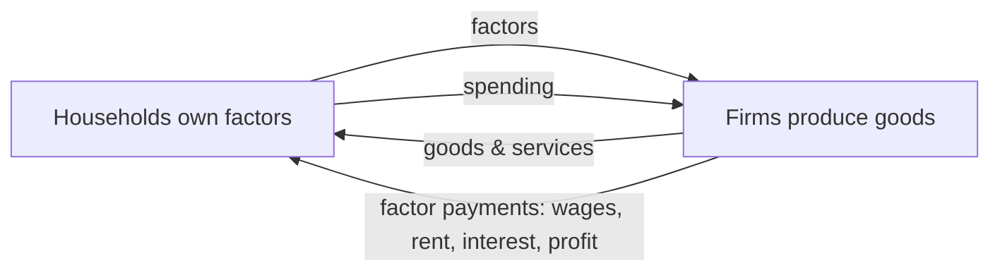

---
tags:
  - economics
  - microeconomics
  - test-prep
aliases:
  - Microeconomics Prep
  - Micro Test Prep
---

# Microeconomics test prep

> [!abstract]
> This note packs the full DSE microeconomics syllabus (compulsory part plus Elective 1, Monopoly Pricing and Competition Policy) into one revision pack. Paper 1 MC and Paper 2 structured questions both draw on everything here. Source notes: [[economics/Microeconomics/Basic Economic Concepts|Basic Economic Concepts]], [[economics/Microeconomics/Firms and Production|Firms and Production]], [[economics/Microeconomics/Market and Price|Market and Price]], [[economics/Microeconomics/Competition and Market Structure|Competition and Market Structure]], [[economics/Microeconomics/Efficiency, Equity and the Role of Government|Efficiency, Equity and the Role of Government]], [[economics/Microeconomics/Monopoly Pricing|Monopoly Pricing]], [[economics/Microeconomics/Anti-competitive Behaviours and Competition Policy|Anti-competitive Behaviours and Competition Policy]].

## Basic economic concepts

Scarcity means wants are unlimited but resources are limited. Scarcity forces **choice**, and every choice has an **opportunity cost**.

| Term | Definition | Exam note |
|---|---|---|
| Free good | Zero price even with zero production cost; quantity available exceeds quantity wanted | A good can become an economic good if demand grows (air in a polluted city) |
| Economic good | Scarce relative to wants; positive price | Almost everything examined is an economic good |
| Opportunity cost | the ==highest-valued option forgone== | Not the sum of all forgone options |
| Explicit cost | Actual monetary payment | Part of total cost |
| Implicit cost | Income forgone from using own resources (e.g. forgone salary) | Missed in accounting profit, included in economic cost |
| Sunk cost | Already spent, unrecoverable | ==Irrelevant to current decisions== |
| Interest | Price of having funds earlier rather than later | Reflects time preference |

**Three basic economic problems** (every economy faces them): **what to produce**, **how to produce**, **for whom to produce**. Solved in practice by tradition, government decision (command), or the market mechanism (price system).

**Private property rights** = exclusive rights to **use**, to **earn income from**, and to **transfer** the resource. Well-defined rights lower transaction costs and make exchange and specialisation possible. Specialisation is only viable with exchange.

Circular flow: household spending = firms' revenue = value of output; factor payments = household income.

| Positive statement | Normative statement |
|---|---|
| What **is**; factual | What **ought to be**; value judgement |
| Can be tested and refuted by evidence | Cannot be tested; involves ethics |
| "A rise in the minimum wage reduces employment of low-skilled workers." | "The government **should** raise the minimum wage." |

## Demand, supply and price

Demand: as own price falls, quantity demanded rises (**law of demand**, *ceteris paribus*). Market demand = horizontal summation of individual demand curves.

| Factor | Shift |
|---|---|
| Income rises | Demand for normal/superior goods shifts right; for inferior goods shifts left |
| Price of substitute rises | Demand shifts right |
| Price of complement rises | Demand shifts left |
| Tastes favourable, population up, expected future price up | Demand shifts right |

Supply: as own price rises, quantity supplied rises. Market supply = horizontal summation.

| Factor | Shift |
|---|---|
| Input cost rises | Supply shifts left |
| Technology improves, more sellers, good weather | Supply shifts right |
| Expected future price rises | ==Supply now shifts left== (hold back for the higher future price) |
| Joint supply | beef↑ → supply of leather↑ |
| Competitive supply | wheat↑ → supply of corn↓ (same land) |

| Phrase in question | Correct response | 
|---|---|
| "The price of X rises" | Quantity demanded/supplied changes: ==move along== the curve |
| "Income rises" / "Cost of raw materials falls" | ==Curve shifts== |

Equilibrium: $Q_d = Q_s$. Surplus above equilibrium → price falls; shortage below → price rises. When both curves shift, one of P or Q is ambiguous (depends on relative shift sizes) — classic MC trap.

**Functions of price**: rationing (allocates to highest-valued users), allocative/signalling (directs resources), incentive (motivates production). All break down under price control, which is why controls need rationing-by-queue or coupons.

**Elasticity** (arc/midpoint and point forms):

$$PED = \frac{\%\Delta Q_d}{\%\Delta P},\qquad PES = \frac{\%\Delta Q_s}{\%\Delta P}$$

| \|PED\| | Type | Price↑ → total revenue |
|---|---|---|
| > 1 | Elastic | falls |
| < 1 | Inelastic | rises |
| = 1 | Unit elastic | unchanged (revenue maximised here) |

PED is high when: close substitutes exist, the good is a luxury, spending takes a large income share, more time to adjust, market narrowly defined. PES rises with time, spare capacity, storability, simplicity of production.
==PED = 0 (vertical D) and PES = 0 (vertical S): price does not affect quantity at all; a tax then falls entirely on the side with zero elasticity.==

| Consumer surplus | Producer surplus |
|---|---|
| max willingness to pay − price actually paid | price received − min acceptable price (MC) |
| area under demand above price | area above supply below price |

Total social surplus = CS + PS, maximised at equilibrium where MB = MC.

**Market intervention** (all create deadweight loss unless they correct a market failure):

| Intervention | Condition to bind | Immediate result | Rationing / notes |
|---|---|---|---|
| Price ceiling | set **below** equilibrium | shortage | queueing, black market, coupons; quality may fall |
| Price floor | set **above** equilibrium | surplus | government buys excess; resources wasted on excess supply |
| Quota | below equilibrium Q | price↑, Q fixed | kinked supply (vertical at quota); surplus → quota holders |
| Unit tax | — | S shifts up by tax; P↑, Q↓ | burden split by ==relative elasticity==; inelastic side pays more |
| Unit subsidy | — | S shifts down; P↓, Q↑ | over-production relative to MB = MC |

DWL in words for a tax: units between the new Q and the old equilibrium had MB > MC but are no longer traded.

> [!tip] Intervention questions: always separate (1) what happens to price, (2) what happens to quantity, (3) who gains/loses surplus, (4) the DWL. Four marking threads in nearly every DSE intervention question.

## Firms and production

| Ownership | Owners | Liability | Continuity |
|---|---|---|---|
| Sole proprietorship | 1 | unlimited | ends with owner |
| Partnership | 2–20 (general partners) | unlimited (limited partners capped) | unstable |
| Limited company | shareholders | ==limited to investment== | perpetual; shares transferable |

Shares = ownership + variable dividend + voting right, riskier. Bonds = debt + fixed interest, paid before dividends, no voting.

Production stages: primary (extraction) → secondary (manufacturing) → tertiary (services); inter-related, tertiary share rises with development. Producer goods make other goods; consumer goods are for final use. ==Public goods are non-rival and non-excludable → free-rider problem → market under-provides==.

Division of labour: simple / complex / regional. Raises productivity (learning by doing, fewer task switches, better matching of task to worker) but causes monotony, interdependence, and structural unemployment risks; limited by the size of the market.

Factors of production: land→rent, labour→wages, capital→interest, entrepreneurship→profit. Fixed factors vs variable factors: a fixed factor's quantity does not change when Q changes; in the ==long run all factors are variable==. Money cost vs real cost (real cost is the forgone alternative use of resources).

**Law of diminishing returns** (short run, variable factor added to fixed factor): MP eventually falls.

TP, AP = TP/L, MP = ΔTP/ΔL. Where MP > AP, AP rises; MP cuts AP at AP's maximum. MP falls to zero → TP is at maximum; MP < 0 → TP falls.

| Cost | Definition | Behaviour |
|---|---|---|
| Fixed cost FC | does not vary with Q (e.g. rent) | still payable at Q = 0 |
| Variable cost VC | varies with Q | includes only avoidable-now costs |
| TC | FC + VC | — |
| AC | TC/Q | — |
| MC | ΔTC/ΔQ | ==MC is unaffected by a rise in FC== |

MC cuts AC at AC's minimum; MC < AC pulls AC down, MC > AC pushes it up. Fixed costs do not appear in MC, so a rental increase shifts AC (and AFC) up but leaves MC unchanged.

Economies of scale — internal: technical (making large machines), managerial (specialised managers), marketing (bulk buying and advertising), financial (cheaper large loans), risk-bearing (diversification). Diseconomies: coordination and communication cost. External economies/diseconomies: to the whole industry (supplier networks vs congestion). LRAC falls when economies outweigh diseconomies. ==Economies of scale are long-run; they are not the same as spreading fixed costs which is short-run==.

Expansion types: vertical (backward to suppliers / forward to distribution), horizontal (same industry), lateral (related industry), conglomerate (unrelated). Motives: market power, cost savings, new markets, risk spreading.

| Structure | Sellers | Product | Entry | Price set? | Long-run profit |
|---|---|---|---|---|---|
| Perfect competition | very many | homogeneous | free | no (taker) | zero (normal profit) |
| Monopolistic competition | many | differentiated | relatively easy | partly | zero in long run (entry erases it) |
| Oligopoly | few | either | blocked by barriers | interdependent | possible |
| Monopoly | one | no close substitutes | blocked | full searcher | persistent supernormal possible |

PC details: P = MR = AR = demand facing the firm (horizontal). Short run: profit, loss, or zero. Long run: entry/exit → P = min AC = MC (both efficiencies). Monopolistic competition: MR = MC but P > MC, excess capacity (Q < min-AC output), non-price competition (brands, service). Oligopoly: few sellers, strategic interdependence, kinked-demand price rigidity, Prisoner's Dilemma instability of collusion (each firm cheats when the other keeps the agreement).

Monopoly sources: franchise, patents/licences, control of key input, natural monopoly, network effects. Monopoly details: MR < P (price cut applies to all units). Profit max at MR = MC, price read from demand curve; supernormal profit can persist behind entry barriers; the monopoly outcome has P > MC, Q < competitive Q, and a DWL triangle between Q_m and Q_c under the demand curve above MC. ==A monopolist has no supply curve: it chooses a point on its MR curve, not a price-quantity pair on a supply curve; different demand curves give different prices at the same quantity==.

MTR as legal-monopoly example: price above MC, entry blocked.

## Efficiency, equity, role of government

**Allocative efficiency**: MB = MC, total social surplus maximised, no DWL. **Productive efficiency**: production at minimum AC. **Pareto efficiency**: no reallocation can make someone better off without making someone worse off.

| Failure | Effect on Q | Fix | DWL after fix |
|---|---|---|---|
| Negative externality: MSC = MPC + MD | over-production (Q_m > Q*) | Pigouvian tax per unit of MD | falls, may reach zero if the tax exactly equals MD |
| Positive externality: MSB = MPB + MEB | under-production (Q_m < Q*) | subsidy, public provision | falls, may reach zero if the subsidy exactly equals MEB |
| Public good: non-rival + non-excludable | under-provision (free riders) | government provision, financed by tax | depends |
| Price ceiling binding | Q < Q* | removal | removed |
| Tax | Q < Q* | removal | removed |

Coase: with well-defined property rights and low transaction costs, private bargaining reaches the efficient outcome regardless of which side holds the rights.

| Equity measure | Reading |
|---|---|
| Lorenz curve | cumulative income share vs cumulative household share; the further from the 45° line, the more unequal |
| Gini coefficient | area between curve and 45° line ÷ area under 45° line; 0 = perfect equality, 1 = one household gets all income; higher = more unequal; HK is high, roughly 0.5 |

Causes of income inequality: differences in human capital (education, skills), ability, amount of capital/property owned, age/life-cycle position, luck, discrimination. Note the causes of unequal **wealth** accumulation differ from causes of unequal **income**.

| Policy type | Examples | Equity–efficiency trade-off |
|---|---|---|
| Transfer / redistribute income | progressive tax, CSSA | high rates reduce work and investment effort |
| Equalise opportunity | free education, public health care, training | lower distortion, builds long-run productivity, but costs public funds now |

Role of government with market failure (HK examples): regulation (laws, emission caps), taxation (per-unit tax on pollution), provision of public goods, subsidies (education), competition law. Round-the-clock street lighting: non-excludable, no private supplier covers cost.

## Monopoly pricing (elective)

**Simple monopoly pricing**: one uniform price for all units. Profit maximisation: MR = MC, price from demand curve, profit = (P − AC) × Q. Number rules:

1. For linear demand P = a − bQ: MR = a − 2bQ (twice the slope).
2. Price elasticity rule for a searcher: MR = P × (1 − 1/\|PED\|); MR > 0 only where \|PED\| > 1, so a profit-maximising monopolist never produces on the inelastic segment (raising price there raises revenue and cuts cost).

Worked example (from Monopoly Pricing notes, re-derivable from scratch in the exam): P = 100 − 2Q, MC = 20 → MR = 100 − 4Q; Q where MR = MC: 100 − 4Q = 20 → Q_m = 20; P_m = 100 − 2(20) = 60; profit = (60 − 20) × 20 = 800; competitive outcome P = MC gives Q_c = 40, DWL = ½ × (Q_c − Q_m) × (P_m − MC) = ½ × 20 × 40 = 400.

**Price discrimination**: same good, different prices, differences not explained by cost. Conditions: (i) searcher (market power), (ii) separable markets with different PEDs, (iii) ==no resale== between groups. A price taker cannot discriminate.

| Degree | How it charges | Perfect information? | Resale problem? | Output/DWL vs uniform |
|---|---|---|---|---|
| First | each buyer willingness-to-pay | yes, per buyer | none needed | rises to competitive Q; no DWL; all surplus to seller |
| Second (block) | prices differ by quantity/quality block; buyers self-select | no | yes | output between uniform monopoly and competitive; DWL shrinks |
| Third (segment) | different PED groups identified by observable trait pay different prices | group PEDs only | must be blocked | for each segment MR_i = MC so MR is equalised; higher price on the ==less elastic== segment (e.g. adults vs students) |

Allocation rule for third-degree discrimination: choose output in each segment so that ==MR_A = MR_B = MC==; if marginal revenues differ, shift output toward the segment with the higher MR.

| Behaviour | Test for price discrimination |
|---|---|
| Student discount at cinemas | second degree? No — third degree (age groups), provided resale is blocked and groups differ in PED |
| Cheaper per-unit price for buying in bulk | second degree (block pricing) — often also just a cost saving; state that if prices differ more than cost differences, it is PD |
| Haggling over car price | first degree (imperfect) |
| Off-peak vs peak fares (MTR) | time-based segmentation if not cost-based; if peak capacity costs more, cost-based pricing is not PD |

**Efficiency effect**: first degree reaches Q_c with no DWL but zero consumer surplus; second/third usually raise output and cut DWL versus simple monopoly. Monopoly profit is higher under discrimination than uniform pricing (never lower), because the discriminator can always fall back on uniform pricing.

## Anti-competitive behaviours and competition policy (Elective)

| Practice | Horizontal (between rivals) or vertical (different levels)? | Example from notes |
|---|---|---|
| Price fixing | horizontal | two supermarket chains agree on the same milk price |
| Market sharing | horizontal | firm A takes district A, firm B takes district B |
| Bid rigging | horizontal | rotating winners of tenders |
| Collective boycott | horizontal | all refuse to deal with a supplier |
| Output restriction | horizontal | OPEC-style quotas |
| Resale price maintenance | vertical | manufacturer sets minimum retail price |
| Exclusive dealing | vertical | retailer may only stock one brand |
| Tying / bundling | vertical | buy product A or no product B |
| Refusal to deal | vertical / unilateral | deny a rival access to an essential input |

Conduct under the HK **Competition Ordinance (Cap. 619)**, in force 14 December 2015, enforced by the Competition Commission:

- **First Conduct Rule**: agreements/ concerted practices that prevent, restrict or distort competition. Price fixing, market sharing, bid rigging and output restrictions are ==serious anti-competitive conduct==, per se contraventions (no efficiency defence). RPM falls under the First Conduct Rule but may be exempted on net-efficiency grounds.
- **Second Conduct Rule**: a firm with ==substantial market power== abusing it (predatory pricing, refusal to supply, tying, margin squeeze, exclusive dealing). Having market power is not illegal; abusing it is.
- Quick test: ==agreement between two or more firms → FCR; unilateral conduct by one dominant firm → SCR==.
- Exemptions/exclusions: statutory bodies, agreements below the de minimis threshold (combined market share under about 10% for FCR safe harbour), mergers (Ordinance does not apply except telecom/broadcasting), employment matters, conduct required by law; efficiency-enhancing agreements may be exempt if consumers benefit.
- Enforcement: Competition Commission investigates; Competition Tribunal fines up to 10% of HK turnover per year of contravention, up to 3 years (and director disqualification); leniency for the first cartel whistleblower; follow-on damages actions.

Both anti-competitive conduct and monopoly raise price above MC, restrict Q and create a DWL; the cartel outcome equals a monopoly outcome when cost structures are identical. Cartels are rarely stable: each member has an incentive to secretly cut price or exceed its quota, which is why the Ordinance offers leniency to the first whistleblower.

==Contrast with efficiency-enhancing cooperation==: joint R&D, standard-setting, and SME cooperation can raise total surplus; competition law does not treat all cooperation as harmful.

## Common mistakes and exam traps

1. Opportunity cost is the ==highest-valued== single forgone option, never the sum. If the two best alternatives are baseball and swimming, the OC of cinema is baseball, not baseball + swimming.
2. The value of an option forgone includes ==non-monetary== parts: forgone earnings, plus any enjoyment given up. Reading a library book for free still has a non-zero OC — the next best use of your time.
3. Time cost rises with the value of your wage: someone earning \$300/hour faces a higher OC of queueing than someone earning \$60/hour, even for the same queue.
4. The three basic economic questions are ==what, how, for whom==. (Do not add "when" or "where".)
5. Free goods exist only where quantity available ≥ quantity wanted at zero price. Water in HK is an economic good; do not assume "natural" = free.
6. ==Change in quantity demanded = movement along== the curve (own price changed); ==change in demand = shift== of the curve (income, tastes, related goods, expectations changed). Same pair of rules for supply vs quantity supplied.
7. Law of demand holds ==ceteris paribus==; when price and incomes rise together, the observed quantity change mixes two effects and cannot verify the law by itself.
8. A price ceiling binds only when set ==below== equilibrium; a price floor binds only ==above== equilibrium. A ceiling above equilibrium changes nothing.
9. Elasticity is about ==percentage== changes, not absolute changes. \|PED\| ignores sign. Moving down a linear demand curve, elasticity falls from elastic to inelastic; a straight-line demand curve has unit elasticity exactly at its midpoint.
10. Elasticity does ==not== equal slope. Two demand curves with the same slope passing through one point have different elasticities; be careful with questions switching between slope and elasticity.
11. A per-unit tax does ==not== necessarily raise the consumer price by the full tax: the burden splits by relative elasticity. ==PED = 0 → consumers bear all of it; PES = 0 → producers bear all==. A per-unit subsidy shifts ==supply down==, not demand.
12. In the circular flow, households buy goods from firms and own the factors; firms sell output and buy factors; the real flow and the money flow move in ==opposite directions==.
13. Fixed cost ≠ sunk cost: fixed costs are ==payable even when Q = 0==, sunk costs are ==already incurred and unrecoverable==. A one-year prepaid non-refundable rent is both; a machine with resale value is fixed but not sunk.
14. MC is unaffected by a change in fixed cost — calculate MC only from changes in variable cost.
15. TP, AP, MP: MP cuts AP at the ==AP maximum==, not at TP's maximum. MP = 0 at the ==TP maximum==. If MP > AP then AP must be rising.
16. ==Economies of scale are long-run== (all factors variable). Spreading overheads by producing more with the same plant is short-run falling average fixed cost, not economies of scale.
17. In perfect competition P = AR = MR; the firm's demand curve is ==horizontal==, market demand is not. "The firm and the industry face the same demand curve" is false.
18. In monopolistic competition, long-run profit is zero (entry erodes it), but the firm still sets P > MC; ==zero profit does not mean no inefficiency==.
19. Monopoly's MR curve lies ==below== its demand curve (for linear demand, twice the slope); read the monopolist's price off the ==demand== curve, never off the MR curve.
20. ==A monopolist has no supply curve==. Do not "derive supply" from the MC curve; a change in demand can raise price with no quantity change, or raise quantity with no price change.
21. Price discrimination requires the ==three conditions== (market power, separable markets with different elasticities, no resale). Age discounts and bulk discounts are classic examples; a uniform price cut for all customers is not discrimination.
22. First-degree discrimination has ==no DWL== but extreme distributional inequality; do not round to "all price discrimination is inefficient".
23. Comparing market structures: entry conditions control ==long-run profit==; product homogeneity and substitution ease control ==market power==. Information is imperfect under oligopoly and monopoly — "perfect information" belongs to perfect competition only.
24. Oligopoly is interdependent: the kinked-demand story predicts ==rivals match price cuts but ignore price rises==; do not explain rigid prices without this asymmetry. Prisoner's Dilemma: collusion is not stable as a Nash equilibrium because each firm gains by defecting.
25. Efficiency ≠ equity. DWL measures the ==efficiency== loss only; distributional effects are separate equity questions.
26. Externality direction: ==negative== externality → private cost understates social cost → market ==over-produces==. ==Positive== externality → market ==under-produces==. Learn the direction of distortion, not the flavour of the good.
27. Lorenz curve/Gini measure ==income== inequality only, not wealth, and say nothing about its cause. A Gini of 0.5 is high; the Lorenz curve can never cross the 45° line or lie below it at any point.
28. ==Price discrimination questions==: always state price, output, profit ==and== distribution effects; a pure efficiency answer misses the consumer-surplus transfer, which is half the marking points.
29. ==FCR vs SCR==: agreements → FCR; unilateral abuse by a firm with substantial market power → SCR. Monopoly itself is not illegal under the Ordinance.
30. When the answer involves tax burden, ==state the relative-elasticity rule in words==, then show the direction (more inelastic side pays more), not just a number.
31. Limited liability means owners of a limited company are liable only up to what they invested in shares, not their personal wealth. In the 2025 exam only about one third of candidates could state this definition correctly, so learn it precisely rather than roughly (2025 HKEAA examiner briefing, Q2b).
32. An externality question tests application, not recitation. The 2025 examiners reported that many candidates wrote the textbook definition of externality or the efficiency condition without applying either to the situation given, and some even explained how an externality was involved when the question said it was ==not== (the word "not" was bolded in the paper).
33. A flat rate is not automatically a proportional tax. Whether a tax is progressive, proportional or regressive is defined by how the ==average tax rate== changes as income rises. In 2025 about half of candidates called a flat 3% levy on accommodation charges proportional without checking what happens to the average rate across income levels (2025 examiner briefing, Q9a).
34. Monopoly is not always inefficient. The curriculum explicitly requires you to explain when monopoly may benefit society, for example economies of scale where duplicating power plants and grids would waste resources, or monopoly profit that funds R&D (2024 HKEAA illustrative questions, Q4b). The DWL analysis in this pack is the default case, not the whole story.
35. Exam elasticity calculations use the ==arc (average) method only==. Point, cross and income elasticity are outside the DSE curriculum (EDB supplementary document), so understand the point form for intuition but never answer a calculation with it when the mark scheme expects the midpoint method.

## Exam skills and strategy

Everything in this section comes from four official documents: the HKEAA 2025 assessment framework, the CDC-HKEAA Economics supplementary document, the HKEAA November 2025 exam briefing (illustration of the 2025 papers with candidate performance data), and the HKEAA 2024 illustrative questions document with suggested mark schemes.

### What the papers look like

| Component | Content | Format | Weighting | Time |
|---|---|---|---|---|
| Paper 1 | compulsory part | 45 MCQs, all compulsory | 30% | 1 hour |
| Paper 2 Section A | compulsory part | 8 short questions, 44 marks, all compulsory | 26% | 2 h 30 min for the whole of Paper 2 |
| Paper 2 Section B | compulsory part | 3 structured/essay-type/data-response questions, 60 marks, all compulsory | 35% | (same sitting) |
| Paper 2 Section C | elective part | 2 structured questions, 16 marks, attempt your one elective only | 9% | (same sitting) |

Paper 2 is marked on screen: each marker grades one question, worth 16 to 28 marks, across 300 to 600 scripts. That is why marks are awarded one per separate, checkable claim rather than as a holistic impression. The appeal success rate is under 1%, so the answer you write is the answer that counts.

Performance intel from the 2025 briefing: the Paper 1 mean was about 55%, and micro items were less accurate than macro items for the second year running. About 65% of candidates chose Elective 1 (monopoly pricing) and averaged 52% on it; the Elective 2 cohort averaged 57%. The assessment objectives also tell you what markers are hunting for: applying concepts to situations (especially Hong Kong ones), interpreting information presented in tables and figures, evaluating arguments from different perspectives, and presenting answers clearly with diagrams and examples.

### Command words and what earns the mark

| Command word | What the mark scheme pays for |
|---|---|
| State / identify | One claim, no elaboration. "State whether Country A engages in complete or partial specialisation" was worth 1 mark and the suggested answer is two words. |
| Calculate | The formula or substitution, then the figure. The illustrative schemes award 1 mark for correct working and 1 mark for the result, so an arithmetic slip still collects the working mark. |
| Explain | A reasoning chain: condition, mechanism, outcome. The 2025 briefing repeatedly credits "well-reasoned explanations" and calls thin answers "piecemeal". One mark, one checkable claim. |
| Indicate (on a diagram) | One mark per correctly drawn or labelled element. In the monopoly illustrative question, the MR curve, QM, PM, the profit rectangle and the DWL each carry their own mark. |
| Compare | Like with like. In 2025 many candidates compared a money cost against a time cost when the question wanted the difference in money cost against the difference in time cost. |
| Discuss / evaluate / justify | Both sides plus a stance. In 2025 Q10d most candidates argued only for the proposal and never against it, and scored poorly. "Justify with ONE reason" means one reason developed properly; the scheme marks the first point only. |

A 3-mark "explain" wants three distinct points, not one point said three ways. Write in short labelled steps so a marker scanning hundreds of scripts finds each claim on its own.

### Paper 1 technique

- Budget: 45 questions in 60 minutes. First pass at about 75 seconds per question leaves roughly 10 minutes for flagged items. There is no penalty for wrong choices, so never leave a blank.
- Statement items (statements I, II and III with combination options) dominate the paper. Judge each statement true or false on its own, write your pattern, then match it to the options. In 2025 the popular wrong option on these items drew 25 to 56% of the vote while the correct key drew as little as 4%, so if your choice is the obvious one on a hard item, re-check it.
- Draw before you choose. For intervention, elasticity and tax incidence items, sketch the diagram from the stem first; the correct option usually falls out of the sketch.
- Watch ceteris paribus distractors. An option that shifts a curve when the stem changes only the good's own price is bait: own-price changes move you along the curve.
- The 2025 briefing lists the cohort's weak spots as interpreting data, conceptual questions, number sense and applying formulas. Read a table's heading, units and axes before touching the options.

### Paper 2 technique

Diagrams. Label the axes (P and Q, or wage and labour), name every curve, mark the points the question names (QM, PM), and label areas with symbols or hatching if you need to refer to them later. Two marking reminders from the 2025 briefing: scripts are scanned in black and white, so areas indicated by colour alone earn nothing, and rough work written outside the designated spaces is not marked.

Words plus picture. Where a question says "with the aid of a diagram", the mark scheme splits between verbal elaboration and diagram elements. Stating MR = MC earns a mark before you draw anything, and a perfect diagram with no sentence loses the verbal marks. Tie your explanation to the picture or the data: "because demand shifts left from D1 to D2, price and quantity both fall".

Calculations. Write the formula, substitute the numbers, give the answer with units. Working earns marks even when the final figure is wrong.

Read harder than feels necessary. The 2025 overall comments report candidates answering as if a bolded "not" were not there, and others regurgitating memorised model answers that did not fit the question in front of them. Check the assumptions and conditions in the stem, and answer the question actually asked.

> [!tip] Scope discipline
> The syllabus marks large areas as NOT required: point, cross and income elasticity; the Coase theorem; the efficiency implications of the different degrees of price discrimination; price and output determination under price discrimination; the shutdown and breakeven points; showing how monopoly profit changes when curves shift; and MR/MC graphical analysis of market structures within the compulsory part. Reading beyond the list is fine, but writing excluded material into answers wastes time and can contradict the marking scheme.

## Practice questions

All scenarios are written for this pack, not taken from past papers.

### Section A: multiple choice (choose one option)

**MC1** Which statement is positive?
- A. Hong Kong should spend more on public housing.
- B. Raising the minimum wage will reduce employment of low-skilled workers.
- C. A Gini coefficient of 0.55 is too high for a developed city.
- D. Competition policy is fairer than price regulation.

**MC2** Peter can spend this Saturday either tutoring for \$600, working a shift at a café for \$480, or resting, which he values at \$300. What is the opportunity cost to him of choosing to tutor?
- A. \$480
- B. \$780
- C. \$300
- D. \$1\,080

**MC3** The price of good X falls and, at the same time, consumers' incomes rise. Good X is a normal good. Which is correct about good X's market?
- A. quantity demanded falls
- B. demand curve shifts left
- C. equilibrium quantity rises; price change cannot be determined
- D. equilibrium price falls; quantity change cannot be determined

**MC4** The demand for a good is perfectly inelastic and the government imposes a per-unit tax on sellers. Which is correct?
- A. sellers bear the whole tax
- B. buyers bear the whole tax
- C. the tax is shared equally
- D. quantity falls to zero

**MC5** A price ceiling is imposed **above** the equilibrium price. What is the effect on price and quantity exchanged?
- A. price falls below equilibrium
- B. quantity exchanged falls
- C. neither price nor quantity exchanged changes
- D. a shortage appears

**MC6** A firm's total fixed cost doubles. Which curve is unaffected?
- A. average cost
- B. average variable cost
- C. average fixed cost
- D. total cost

**MC7** Which statement about a firm in perfect competition is correct?
- A. It can earn supernormal profit in the long run.
- B. Its marginal revenue equals the market price.
- C. Its demand curve is downward sloping.
- D. It advertises heavily to differentiate its product.

**MC8** A profit-maximising monopolist will never produce on the part of its demand curve where
- A. MR is negative.
- B. price exceeds marginal cost.
- C. demand is elastic.
- D. price exceeds average cost.

### Section B: short answer

**SA1** Define opportunity cost and explain why the opportunity cost of attending university for a student who could otherwise work full-time includes more than tuition fees.

**SA2** A bakery can produce bread or cakes. Moving from 100 loaves to 120 loaves costs it 8 cakes. Moving from 120 to 130 loaves costs it 6 cakes. Explain what this implies about opportunity cost and the shape of the production possibility curve (PPC).

**SA3** With the aid of a demand-supply diagram (describe it in words), explain the effects on the market for umbrella of an unusually hot, dry summer. State what happens to equilibrium price and quantity.

**SA4** Good A's price rises from \$10 to \$12 and quantity demanded falls from 200 to 160 per month. Calculate the price elasticity of demand using the midpoint (arc) method and classify the demand. State what happens to sellers' total revenue.

**SA5** Distinguish between a sunk cost and a fixed cost, using one example of a cost that is fixed but not sunk.

**SA6** Explain why a firm in monopolistic competition earns zero profit in the long run yet still charges a price above marginal cost.

### Section C: structured / data-response

**SD1** — the campus bubble tea market
A university has 12 bubble tea shops. All sell broadly similar drinks, entry costs are modest, and students compare prices easily. Recently one shop introduced app-only discounts, and two shops closed.
(a) Identify the market structure and justify with two features. (3 marks)
(b) Both remaining sellers announce the same price increase within a day of each other. Explain whether this is evidence of collusion. (3 marks)
(c) Suppose demand for bubble tea is price elastic. A shop raises price. Using total revenue logic, explain what you expect to observe and why this limits price increases. (3 marks)

**SD2** — the franchised peak fare
A city's rail operator holds a legal franchise, is the only seller of rail rides, and charges a single fare for all adults all day. Its economists estimate that fare elasticity differs sharply between the morning peak (business travellers, inelastic) and off-peak hours (leisure travellers, elastic). Table:

| Time | Willingness to pay (fare/hour of service) | Cost per hour of train service |
|---|---|---|
| Peak | \$80 for the first 100 customers, declining to \$40 by the 400th | \$30 |
| Off-peak | \$32 for the first 100 customers, declining to \$18 by the 400th | \$15 |
(a) At the single uniform price of \$50, sketch which groups are excluded and state a deadweight loss direction (no diagram required). (3 marks)
(b) The operator considers charging \$45 during peak hours and \$20 off-peak. Which price discrimination degree is this, and what conditions must hold for it to be feasible? (4 marks)
(c) Explain the effect of this pricing change on output and on the operator's profit, relative to a single price. (4 marks)

**SD3** — orchid farms by a reservoir (externality + intervention)
Orchid farms near a reservoir use a fungicide that runs off into the water. The reservoir authority supplies water to 200,000 households. Private marginal cost per kg of orchids is \$8; marginal external cost is \$4 constant; demand is P = 30 − 0.5Q (P in \$ per kg, Q in '000 kg per month).
(a) Calculate the market equilibrium quantity and the socially efficient quantity. Show working. (5 marks)
(b) Calculate the deadweight loss at the market equilibrium. (3 marks)
(c) The authority proposes a per-kg tax. State the tax rate that restores efficiency and calculate the new market price and quantity. (4 marks)

**SD4** — competition policy short case (anti-competitive behaviours)
Three roofing contractors in a district agree at a dinner: (i) all quote at least \$90 per square metre for new roofs; (ii) each takes turns winning the government's school-roof tenders; (iii) they will stop supplying Firm L, a new entrant quoting \$70. Firm L complains to the Competition Commission.
(a) Classify the three agreements by type (horizontal/vertical) and by the conduct rule they contravene. (5 marks)
(b) Explain why the tender agreement is treated as a serious anti-competitive conduct without permitting an efficiency defence. (2 marks)
(c) Firm L also claims the established firms now price below cost to squeeze it out. What is this behaviour called, and which rule would apply if a single dominant firm did it unilaterally? (3 marks)

**SD5** — income inequality in two districts

| | District M | District N |
|---|---|---|
| Gini coefficient (income) | 0.53 | 0.41 |
| Access to free secondary education | universal since 1980s | recently expanded |
| Minimum wage | none until 2010, low level | moderate level |

(a) Using the Lorenz curve concept, explain what a Gini of 0.53 tells you that a single household income figure cannot. (3 marks)
(b) For each district, classify one policy as equalising income and one as equalising opportunity. (4 marks)
(c) Explain one way an aggressive minimum wage might reduce the equality it aims to promote. (3 marks)

## Model answers

**MC1** — B. It is testable and refutable by evidence. A, C, D contain "should"/"too"/"fairer" value judgments (A and C evaluate; D is partly factual but "fairer" is normative). Note a positive statement can be false; being wrong does not make it normative.

**MC2** — A (\$480). The tutoring fee is what Peter gains, not what he gives up; B double-counts both alternatives; C is the least-valued option. The café shift at \$480 is the highest-valued option given up.

**MC3** — C. The price fall itself means supply shifted right (a movement along the curve needs a cause, and only a supply shift lowers price). Supply↑ raises Q and lowers P; the income rise shifts demand right, raising both P and Q. Quantity therefore rises from both effects, but price is pushed down by supply and up by demand, so its direction depends on relative shift sizes.

**MC4** — B. With perfectly inelastic demand the quantity is unchanged by the tax, so buyers cannot escape it; the whole tax is passed on in a higher price. D is wrong because quantity does not change.

**MC5** — C. A ceiling only binds (forces price below market level) when set **below** equilibrium. Above equilibrium the ceiling is not effective: price stays at equilibrium and Q = Q*, so no shortage and no quantity change. Nothing prevents the equilibrium from being reached.

**MC6** — B. AVC = VC/Q is built only from variable cost, so a fixed cost increase leaves it unchanged. AFC rises (spread over the same output), and AC = AFC + AVC rises too.

**MC7** — B. Competitive firms are price takers: every extra unit sells at the market price, so MR = P. Long-run profit is zero (entry), so A is wrong; the firm's demand curve is horizontal, so C is wrong; products are homogeneous, so heavy differentiation advertising is out of place, D is wrong.

**MC8** — A. MR < 0 means extra output *reduces* revenue (inelastic segment), so it is never profitable to produce there. C is wrong because elastic demand is precisely where a profit maximiser *does* produce; B is normal for a monopolist and can still be profit-maximising; high price is fine if AC is low enough.

**SA1** — Opportunity cost is the highest-valued option forgone when a choice is made. For a student, the forgone full-time wage is the implicit cost. The out-of-pocket explicit cost is tuition; the implicit forgone salary (and any promotion forgone) is part of OC even though no money changes hands. Total OC = forgone salary + tuition (assuming no other option ranks higher). Marks: definition (1); forgone earnings as implicit cost (1); must be the highest-valued forgone option (1); total OC includes both explicit and implicit parts (1).

**SA2** — Opportunity cost per loaf **rises** as bread output increases: 8 cakes ÷ 20 loaves = 0.4 cakes per loaf over the first move, then 6 ÷ 10 = 0.6 cakes per loaf over the second. Rising opportunity cost implies the PPC is **concave (bowed outward)**: resources are not equally suited to both goods, so shifting production toward bread costs more and more cake forgone. Marks: OC per loaf computed and rising (1); concave/bowed-out PPC (1); explanation via resources not perfectly adaptable between uses (1).

> [!tip] State opportunity cost **per unit** (cakes forgone ÷ loaves gained), not as a lump sum. DSE markers want the per-unit figure before the curve shape.

**SA3** — Hot dry summer (no rain) reduces the desire to buy umbrellas; demand curve shifts **left**. Supply is unaffected in the short run (shops already stocked). Result: equilibrium **price falls**, equilibrium **quantity falls**. Diagram description: axes price (P) and quantity (Q); original demand D₁ and supply S cross at E₁; new demand D₂ left of D₁; new equilibrium E₂ south-west of E₁. Marks: identify determinant (tastes/weather) shifts demand (1); direction correct (1); both P and Q fall (1); reasoning via surplus at old price (1).

**SA4** — Midpoint: ΔQ/average Q = (160−200)/((200+160)/2) = −40/180 = −0.222; ΔP/average P = (12−10)/((10+12)/2) = 2/11 = 0.1818. PED = −0.222/0.1818 = **−1.22** (magnitude ≈ 1.22). Elastic (>1). Revenue effect: from \$2 000 (= \$10 × 200) to \$1\,920 (= \$12 × 160): falls by \$80, consistent with elastic demand where price and total revenue move in opposite directions. Marks: correct formula and substitution (2); value 1.22 (1); elastic classification with total-revenue check (2).

**SA5** — Sunk cost: money already spent that cannot be recovered by any current or future choice; it should be ignored in decision-making. Fixed cost: a cost that does not vary with output in the short run **but** may be recoverable. Example fixed-but-not-sunk: a leased display fridge — the lease payment is the same whether the shop sells 10 or 100 drinks (fixed) but the fridge has resale/scrap value, so part of the outlay is recoverable (not sunk). Marks: correct definitions (2); one valid example with the reason it is fixed but not sunk (2).

**SA6** — Long-run zero profit: free entry means supernormal profits attract new shops offering similar products, shifting each firm's demand left until price = average cost (P = AC), where profit = 0. Price still above MC: each firm faces a downward-sloping demand curve (products differentiated), so MR < P. With MR = MC at the profit-maximising output, P > MC. This gap is the allocative inefficiency (excess capacity) that persists even with zero profit. Marks: entry process drives profit to zero (1); differentiation gives downward-sloping demand (1); MR < P so P > MC at MR = MC (1); zero profit ≠ efficiency (1).

**SD1(a)** — Monopolistic competition. Features: (i) **many sellers** (12 shops), (ii) **differentiated product** ("broadly similar" drinks, shop brands differ), (iii) **easy entry** (modest set-up costs; actually two shops closing implies easy exit as well). Because products differ slightly but substitutes abound, each shop has limited pricing power. Marks: structure (1); any two valid supporting features (1 each).

**SD1(b)** — Simultaneous price increases can arise from independent reaction to a common cause, so they are not by themselves proof of collusion. Legitimate explanations: the same wholesale price for tea leaves or milk rising for both shops, or both reacting to the same public market information. Collusion would require an ==agreement or concerted practice==; identical prices are only an **indicator** the Commission would look at alongside communications, stability of prices, and pattern-of-conduct evidence. Marks: not proof alone (1); innocent common-cause explanation (1); what an enforcer would additionally examine (1).

**SD1(c)** — With elastic demand, the % fall in quantity demanded exceeds the % rise in price, so total revenue = P × Q **falls**. Example numbers: 200 cups at \$10 = \$2 000; at \$11, quantity drops 12% to 176, TR = \$1 936. Each shop therefore cannot profitably raise price far; competition is restrained to modest mark-ups, matching the monopolistic-competition prediction. Marks: elastic-demand revenue logic (2); application using own numbers (1); conclusion that price rises are self-limiting (1).

**SD2(a)** — At \$50: peak business travellers with willingness to pay between \$40 and \$50 between the 100th and 400th customers get turned away (they would have paid \$40–49), and almost all off-peak travellers with WTP below \$50 (\$18–32) are excluded. Deadweight loss arises from all the trips where WTP ≥ MC but price exceeds WTP: peak hours, WTP down to \$40 ≥ MC of \$30, so units between \$40 and \$50 are lost; off-peak hours, WTP up to \$32 < \$50, so the entire off-peak market disappears even though WTP ≥ MC of \$15. Marks: identify who is excluded at \$50 (1); peak lost trades between P and MC (1); off-peak fully excluded though efficient (1).

**SD2(b)** — Third-degree (market segmentation) price discrimination: the operator charges different uniform prices to two separable groups identified by a time credential (peak vs off-peak ticket). Conditions: (i) **market power** — it is the sole seller; (ii) **separable sub-markets** with different PEDs — peak business travellers vs off-peak leisure travellers, separable by ticket type; (iii) **no resale** — a rail ride cannot be resold or transferred easily, satisfying the condition. Marks: degree named (1); each condition checked against the facts (3 × 1).

**SD2(c)** — Output: by dropping the off-peak fare to \$20 while WTP reaches \$32 ≥ MC of \$15, trips that previously did not happen now occur. Total quantity rises (peak may stay similar; off-peak expands toward where WTP ≥ MC). This moves the market closer to allocative efficiency (P closer to MC), shrinking the deadweight loss that the uniform \$50 price created. Profit: the operator gains because each segment is now priced above its own MC and close to each segment's willingness to pay; the profit is higher than under a single price since the operator had left money on the table from business travellers (peak WTP was far above \$50) and had an unserved off-peak market. Numbers illustrative: at \$50 peak (100 customers) revenue = \$5 000; after (400 customers at \$45) = \$18 000. Marks: output rises / off-peak market expands (1–2); DWL shrinks / P moves closer to MC (1); profit rises vs single price (1).

**SD3(a)** — Market equilibrium: set private MC = demand: \$8 = 30 − 0.5Q → 0.5Q = 22 → Q = 44 ('000 kg). Socially efficient quantity: set MSC = demand: (8 + 4) = 30 − 0.5Q → 12 = 30 − 0.5Q → 0.5Q = 18 → Q = 36 ('000 kg). Market quantity (44) exceeds the efficient quantity (36) by 8 ('000 kg) — over-production, as expected with a negative externality. Marks: market quantity 44 with working (2); MSC = 12 stated (1); efficient quantity 36 with working (2).

**SD3(b)** — Deadweight loss = area of the triangle between Q_efficient = 36 and Q_market = 44. Height of triangle = vertical distance between demand (MSB) and MSC at Q = 44: at Q = 44 demand price = 30 − 0.5(44) = \$8; MSC = \$12; difference = \$4. Area = ½ × base × height = ½ × 8 × 4 = **16** (in \$'000 per month, since Q is in '000 kg). Marks: correct triangle identification between Q_m and Q_s (1); height = \$4 (1); area = 16 with units (1).

**SD3(c)** — Efficient tax rate = marginal external cost = **\$4 per kg** (Pigouvian tax). This shifts the supply/MPC curve up by \$4 to coincide with MSC. New equilibrium: set MSC = demand: \$12 = 30 − 0.5Q, same as the efficient outcome: Q = 36 ('000 kg). Market price consumers pay: read off demand at Q = 36: P = 30 − 0.5(36) = \$12. Producers' net-of-tax price: P − 4 = \$8. Marks: \$4 per kg (1); new Q = 36 (1); new price = \$12 (1); producer price \$8 noted (1).

> [!tip] The size of the price increase to consumers is not necessarily the same as the tax rate; here it is exactly \$4 because supply was assumed horizontal at \$8, so with a horizontal supply curve the whole tax is passed to consumers.

**SD4(a)** — All three agreements are ==horizontal==: roofing contractors are at the same level of the supply chain (all sell new roofs). (i) The \$90 minimum quote is **price fixing** — the object is direct: to fix or raise prices between competitors; contravenes the **First Conduct Rule (FCR)**. (ii) Turn-taking in tenders is **bid rigging**: horizontal collusion to restrict competition for government contracts; also FCR (and a "serious anti-competitive conduct" category). (iii) Stopping supply to the new entrant is a ==collective boycott== — horizontal agreement to exclude a competitor; again FCR (serious conduct category since it is designed to exclude/limit a rival). Marks: horizontal classification (1); price fixing + FCR (1); bid rigging identified + FCR (1); collective boycott/boycott of the entrant + FCR (1); conduct rule named each time (1).

**SD4(b)** — Bid rigging and similar horizontal agreements on price, market sharing, output or boycotts are treated as **serious anti-competitive conduct** under the Competition Ordinance: the harm is so direct and large (restricted competition, higher prices for the same service, waste of public funds on inflated tenders) that no efficiency claim can justify it — they are judged on their object without allowing a net-efficiency exemption, unlike some vertical restraints which get a "rule of reason" standard. Marks: serious anti-competitive conduct (1); no efficiency defence permitted (1).

**SD4(c)** — Pricing below cost to squeeze Firm L is ==predatory pricing==. If carried out by a single firm with substantial market power acting unilaterally it would fall under the **Second Conduct Rule (SCR)** — abuse of substantial market power — since a dominant firm driving out a rival with losses, planning later to recoup via higher prices, is a classic abuse. Here it is several firms together, so it could still be analysed under FCR as collective conduct. Marks: predatory pricing named (1); SCR (1); unilateral condition stated (1).

**SD5(a)** — A Gini coefficient of 0.53 summarises the ==shape of the Lorenz curve==: the area between the line of perfect equality (45°) and the Lorenz curve as a proportion of the area under the 45° line. It tells you the ==distribution== of income, not the level: many households may be below the average; the higher the number (approaching 1), the more the cumulative income share falls short of the cumulative household share. A Gini of 0.53 is high for a developed economy and implies, e.g., substantial income concentration among top households. Marks: Gini defined via areas under/between curves (1–2); interpretation "higher = more unequal" and "measures distribution independent of income level" (1 each, max 3).

**SD5(b)** — District M: (income-equalising) transfer payments/progressive tax (Cash allowance: CSSA-type transfers); (opportunity-equalising) universal free secondary education since the 1980s. District N: (income-equalising) a moderate minimum wage raising low-wage income — though see (c); (opportunity-equalising) recent expansion of free education + vocational training, which raises human capital without direct transfers. Marks: correctly matching each district's policy to income vs opportunity (4 × 1).

**SD5(c)** — If the minimum wage is set too aggressively above the market-clearing wage, demand for low-skilled labour contracts: employers reduce hiring of exactly the people the policy aims to help, and may substitute automation. Some low-skilled workers lose employment or have hours cut; ==inequality among low-income households can widen== (the employed low-skilled gain more, the unemployed lose entirely). This is the equity-efficiency trade-off: the redistributive instrument itself distorts the labour market. Marks: employment reduction mechanism (1–2); inequality among low-income group can widen (1–2, max 3).

> [!tip] Marks-style answers above model DSE allocation: state the rule, apply it with numbers from the question, then conclude in one sentence. In structured questions each mark usually corresponds to one separate, checkable claim.
