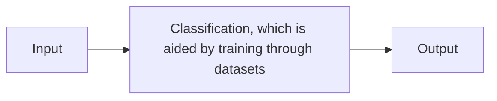

# Big data
Data is collected in the **Internet of Things**

> [!info] 4V's of Big Data
> **volume**, **variety**, **velocity** and **veracity**

# Artificial Intelligence
## Machine Learning
Definition: training itself by reading sample data.

> [!info] Steps of Machine Learning
> ```mermaid
flowchart LR
    A[Provide Data] --> B[Find patterns]
    B --> C[Generate Model]
    C --> D[Obtain predictions]
> ```

> [!info] Supervised learning
> Training a computer with labelled datasets is **supervised learning**. 
> Algorithms used are more explicit and improves automatically with training data. Computers are trained to make an informed decision. 
> 
> Conversely, training with unlabelled data is known as **unsupervised learning**. This takes longer to train, using [[Artificial Neural Networks and Deep Learning | artificial neural networks]] which can solve more complex problems. 
> 

# Pattern recognition in AI
### Stage 1: Training

### Stage 2: Prediction

## Image Recognition
To recognise patterns within images, training data is gathered by scanning pixels on different images. 
### Facial Recognition

### Computer Vision
## Speech Recognition
Voices can be distinguished by different ==pitches== and ==volumes== at different time intervals. This forms unique and distinctive ==waveforms==. Such features are captured through a process named **digitalisation**. 