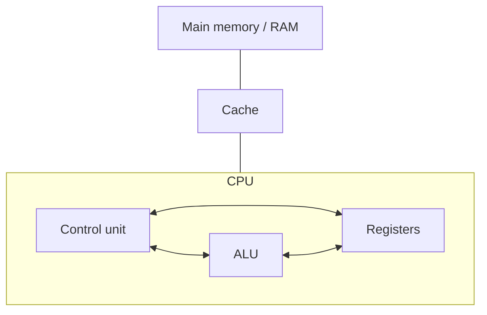
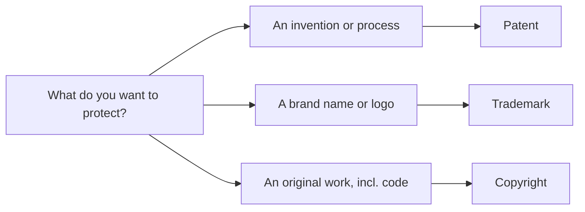

---
tags:
  - ict
  - compulsory
  - test-prep
aliases:
  - ICT Prep B and E
---

# ICT compulsory B and E test prep

> [!abstract] Scope
> This pack covers HKDSE ICT Compulsory Module B (Computer System Fundamentals, 20h) and Module E (Social Implications, 8h). It condenses the module notes into exam-ready summaries, lists the traps that cost marks most often, then gives practice questions with full model answers.
> Sources: [[ict/Archive/ai notes/Compulsory/B|Module B]] and [[ict/Archive/ai notes/Compulsory/E|Module E]]. Rewrite of that material in my own words, structured for revision.

---

# 1 Module B key concepts

## 1.1 Hardware and software

A computer system has two halves. ==Hardware== is every physical part you can touch: CPU, memory, keyboard, monitor. ==Software== is the set of programs that runs on that hardware. The two layers sit in a fixed order: application software runs on top of the operating system, the operating system runs on top of the hardware. A single program cannot bypass this chain in normal use.

| | Hardware | Software |
| :--- | :--- | :--- |
| Nature | Physical components | Programs and instructions |
| Fails by | Wear, breakage, electrical damage | Bugs, corruption, viruses |
| Example | CPU, RAM, SSD, printer | OS, drivers, word processor |

## 1.2 Input and output devices

An ==input device== sends data into the computer; an ==output device== presents processed data to the user. Some devices do both, such as a touchscreen.

| Input device | What it sends in | Typical use |
| :--- | :--- | :--- |
| Keyboard | Text and commands | Documents, data entry |
| Mouse / touchpad | Pointer position, clicks | GUI navigation |
| Scanner | Digitised image of a document | Digitising paper records |
| Microphone | Audio | Recording, voice control |
| Touchscreen | Touch position (and receives display) | Phones, kiosks |
| Barcode reader / camera | Encoded or image data | Retail checkouts, ID checks |

| Output device | What it presents | Typical use |
| :--- | :--- | :--- |
| Monitor | Visual display | All general computing |
| Printer | Hard copy | Reports, receipts, posters |
| Speaker / headphone | Audio | Media, alerts, accessibility |

> [!tip] Exam tip
> When a question asks you to "select a suitable device and justify it", give one device, then two reasons tied to the scenario (speed, accuracy, cost, environment). Generic reasons score little.

## 1.3 The CPU

The ==CPU== executes instructions. In the DSE syllabus it consists of three parts: the ==control unit (CU)==, the ==arithmetic logic unit (ALU)==, and ==registers==. Cache sits between the CPU and RAM but is ==not== one of these three CPU parts. The C&A guide lists processing units as the ==CPU== and the ==GPU== (graphics processing unit), so name the GPU too if a question asks what counts as a processing unit.

| Component | Job |
| :--- | :--- |
| ==CU== | Fetches, decodes instructions and sends control signals that direct the other parts |
| ==ALU== | Does arithmetic (add, subtract, multiply, divide) and logic (AND, OR, NOT, comparisons) |
| ==Registers== | Very small, very fast storage inside the CPU for data and addresses in use |

Key registers to know:

| Register | What it holds |
| :--- | :--- |
| ==PC== (program counter) | Address of the **next** instruction |
| ==MAR== (memory address register) | Address currently being read from or written to |
| ==MDR== (memory data register) | Data or instruction being transferred to or from memory |
| ==CIR== (current instruction register) | The instruction being decoded and executed now |
| ==Accumulator== | Intermediate results of ALU work |

## 1.4 The bus system and the machine cycle

A ==bus== is a set of wires carrying signals between components. Three buses matter:

| Bus | Carries | Direction |
| :--- | :--- | :--- |
| ==Data bus== | The actual data and instructions | ==Bidirectional== (read and write) |
| ==Address bus== | Memory addresses | ==Unidirectional==, CPU to memory |
| ==Control bus== | Control signals: read/write, interrupt, clock | Varies per signal |

Bus ==width== fixes how much moves at once: a 32-bit data bus moves 32 bits per transfer, and a 32-bit address bus can reach 2³² addresses.

The ==machine cycle== (fetch-decode-execute) repeats for every instruction:

| Step | What happens | Registers used |
| :--- | :--- | :--- |
| ==Fetch== | Address in PC is copied to MAR; the instruction at that address travels to MDR, then to CIR; PC is incremented | PC, MAR, MDR, CIR |
| ==Decode== | CU works out what the instruction in CIR requires | CU, CIR |
| ==Execute== | ALU performs the operation, or data moves; result goes to the accumulator or memory | ALU, accumulator, MDR |

Clock speed, measured in GHz, counts cycles per second. The guide also expects the small time units: microsecond, nanosecond and picosecond. Faster clock, more cores and better architecture all raise performance, but clock speed alone does not.

## 1.5 Main memory and secondary storage

==Main memory== holds data and instructions currently in use, directly accessible by the CPU.

| Memory | Volatile? | Role |
| :--- | :--- | :--- |
| ==RAM== | Yes, contents lost on power off | Working storage for running programs |
| ==ROM== | No | Firmware, boot instructions, hard to change |
| ==Cache== | Yes | Copies of frequently used data, sits between CPU and RAM |

==Secondary storage== keeps data permanently when power is off.

| Device | Technology | Access | Speed | Capacity | Durability |
| :--- | :--- | :--- | :--- | :--- | :--- |
| ==HDD== | Spinning magnetic platters | Random, mechanical | Slow (~100-200 MB/s) | Very high, cheap per GB | Low, moving parts |
| ==SSD== | Flash memory | Random, electronic | Fast (~500+ MB/s) | Medium, costlier per GB | High, no moving parts |
| ==Optical disc== (CD/DVD/Blu-ray) | Laser reading pits | Random, slow | Very slow | Low (700 MB to 25 GB) | Scratches damage it |
| ==Magnetic tape== | Magnetic ribbon | ==Sequential only== | Slow | Very high, cheapest per GB | High, good for archives |

> [!tip] Comparing storage
> When a question says "compare storage devices" or "justify a choice", hit these four criteria: access method, volatility, transfer speed, capacity and cost. Pick the criterion the scenario cares about (durability for a laptop carried daily, cost per GB for bulk archive).

## 1.6 System software

==System software== manages the hardware and provides a platform for ==application software==, which does the user's actual work.

### Operating system functions

| Function | What it does |
| :--- | :--- |
| ==Memory management== | Allocates RAM to programs, handles virtual memory |
| ==Process management== | Schedules tasks, supports multitasking, handles interrupts |
| ==File management== | Organises files in folders, controls access rights |
| ==Device management== | Talks to peripherals through ==device drivers== |
| ==User interface== | Provides GUI or CLI |
| ==Security== | Login authentication, permissions |

### Application software types

| Type | Description | Example |
| :--- | :--- | :--- |
| ==General-purpose== | Packaged for a wide audience, many uses | Word processor, spreadsheet |
| ==Tailor-made== | Custom written for one organisation's needs | Payroll system built for a bank |

Utility programs (disk cleanup, virus checker, file compression, defragmentation for HDDs only) are system software, not application software.

==Driver programs== are examined directly. A driver lets the operating system communicate with one specific device: it interprets commands or print jobs for that device and passes its error messages back. Updating to the latest driver keeps compatibility with the OS and fixes known bugs. In 2025 a Section B question asked for the major function of a printer driver and only a small number of candidates gave the core function (communication between device and OS).

Modes of operation is a short examinable list: ==batch processing== (jobs collected and run later with no interaction), ==real-time processing== (responds within a guaranteed time), ==parallel processing== (several processors share one task), ==distributed processing== (work spread across networked computers) and ==virtualisation== (one physical machine hosts several virtual machines).

### User interface types

| UI | How it works | Good for |
| :--- | :--- | :--- |
| ==CLI== | User types commands | Experts, automation, low resource use |
| ==GUI== | Windows, icons, menus, pointer | Beginners, visual tasks |
| ==Touch / voice== | Taps, gestures, speech | Mobile devices, accessibility |

---

# 2 Module E key concepts

## 2.1 Technological innovations

==Technological innovation== means new technologies, or new uses of existing ones, that change how society and industries work.

| Innovation | Core idea | Examples |
| :--- | :--- | :--- |
| ==Data science== | Extracting insight from large data sets | Sales forecasting, city planning |
| ==Artificial intelligence / machine learning== | Systems that learn from data and improve without being reprogrammed line by line | Fraud detection, recommendation engines |
| ==Pattern recognition== | Algorithms that find regularities in data | Facial recognition, speech recognition, medical image diagnosis |
| ==3D printing== | ==Additive manufacturing==: builds a physical object ==layer by layer== from a digital model | Custom prosthetics, prototypes, printed food |
| ==AR / VR / MR== | See table below | Games, training simulators |

| Technology | Definition | Example |
| :--- | :--- | :--- |
| ==AR== (augmented reality) | Overlays digital content on the real world | AR navigation, filter apps |
| ==VR== (virtual reality) | Fully immersive digital environment | Headset flight simulator |
| ==MR== (mixed reality) | Real and virtual objects interact | Holographic design tools |

## 2.2 Health hazards and ergonomics

| Hazard | Cause | Typical symptom |
| :--- | :--- | :--- |
| ==Repetitive strain injury (RSI)== | Repeated typing or mouse motions, bent wrists | Pain or tingling in wrists, hands, arms |
| ==Computer vision syndrome== | Long unbroken screen time, glare, dry eyes | Blurred vision, sore or dry eyes, headaches |
| ==Back and neck pain== | Poor posture, wrong chair or monitor height | Stiffness, aching spine and shoulders |
| ==Sleep disruption== | Screen light late at night | Poor sleep quality |

==Ergonomics== is designing the workstation to fit the user so discomfort and injury are reduced. The standard setup:

- Chair with lumbar support, feet flat on the floor, thighs level.
- Monitor about an arm's length away, top of screen at or slightly below eye level.
- Elbows at about 90 degrees, wrists straight when typing.
- Screen lighting without glare.
- Regular breaks, the ==20-20-20 rule==: every 20 minutes, look at something 20 feet away for 20 seconds.

Software design also matters: adjustable font sizes, dark mode, keyboard shortcuts and simple layouts all cut strain.

## 2.3 Ethics, intellectual property and responsible computing

==Plagiarism== is presenting someone else's work as your own without attribution. ==Software piracy== is copying, distributing or using copyrighted software without a licence. They overlap but are not the same: copying a friend's program with permission still fails, because the licence does not allow it.

==Intellectual property (IP)== is ownership of creations of the mind.

| Protection | Covers | Example |
| :--- | :--- | :--- |
| ==Copyright== | Original works: text, music, films, software code | A novel, an app's source code |
| ==Trademark== | Brand names, logos, slogans | A company logo |
| ==Patent== | Inventions and processes | A new machine mechanism |
| ==Trade secret== | Confidential business information | A secret formula |

Software licences:

| Licence | Free to use? | Free to modify? | Example pattern |
| :--- | :--- | :--- | :--- |
| ==Freeware== | Yes | No | Free utility app |
| ==Shareware== | Trial only | No | Paid after trial period |
| ==Open source== | Yes | Yes, redistribute too | Community-developed OS |
| ==Proprietary== | No, paid licence | No | Commercial office suite |

Read the licence table from both sides, as the guide requires: for ==users== the scheme decides cost, freedom to modify and what support exists; for ==developers== it decides how the work earns money and whether others may build on it (open source developers may still charge for support, hosting or enterprise versions). A "discuss the benefits and risks" question on a licence scheme should touch both perspectives.

Hong Kong law: the ==Copyright Ordinance (Cap. 528)== makes unauthorised distribution of copyrighted works an offence, with fines per infringing copy and imprisonment for serious cases. Ignorance of the law is no defence.

Ways owners reduce IP theft: ==digital watermarking==, ==digital signatures==, ==DRM== technology, clear ==licence agreements==, and registration of IP rights.

==Responsible computing== covers the personal side of ethics: respect IP, protect others' personal data, use ICT only for legitimate purposes, be honest online, and act against cyberbullying rather than forwarding it.

### Equity of access

The guide's Module E outcomes include ==equity of access==. Know the three angles: the ==digital divide== (gap between people with and without affordable access to devices and networks), ==gender equity== in ICT participation, and ==access for the disabled== (screen readers, captions, adjustable interfaces). Also be ready to weigh ==freedom of information== on the Internet: free flow of knowledge and public scrutiny on the one hand, misinformation, privacy loss and unequal ability to use the information on the other.

---

## Common mistakes and exam traps

1. **CPU composition.** The CPU is CU + ALU + registers. Cache is ==not== a CPU component; it is separate memory between CPU and RAM. Writing "CU, ALU, registers and cache" in a "state the parts of the CPU" question loses marks.
2. **Bus directionality.** The address bus is unidirectional (CPU to memory). The data bus is bidirectional because data is both read and written. Questions love this distinction.
3. **PC vs CIR.** The PC holds the address of the ==next== instruction, the CIR holds the instruction being processed ==now==. Mixing these up is the classic fetch-execute trap.
4. **1 KB = 1024 bytes**, not 1000, in DSE calculations. Use powers of 2.
5. **Volatile vs non-volatile.** RAM is volatile, ROM and all secondary storage are not. Saying "SSD loses data when powered off" is wrong.
6. **Sequential vs random access.** Tape is sequential ==only==. Optical discs support random access (slow). Writing "optical discs are sequential" mislabels them.
7. **SSD vs HDD selection.** Match criteria to the scenario: SSD for speed and durability (laptop, video editing), HDD for cheap high capacity (bulk backup). Never justify "SSD is better" without naming a criterion.
8. **Defragmentation applies to HDDs only.** SSDs need no defragmentation; suggesting it for an SSD shows misunderstanding.
9. **Copyright vs patent vs trademark.** Copyright protects original works including software code, a patent protects an invention or process, a trademark protects brand identity. A question naming "a new device mechanism" wants ==patent==, not copyright.
10. **Freeware is not open source.** Freeware is free to use but usually closed; open source allows modification and redistribution. This comparison appears repeatedly in past papers.
11. **Plagiarism vs piracy.** Plagiarism is about attribution (claiming authorship), piracy is about licensing (unauthorised copying). An answer that swaps them scores zero on that point.
12. **Module E questions want examples.** "Discuss the impact of X" questions expect named real applications or Hong Kong legal references (Copyright Ordinance, Cap. 528). A generic essay without examples caps at about half marks.
13. **RSI answers need both hazard and remedy.** Naming symptoms earns little alone; pair each hazard with an ergonomic fix (breaks, wrist support, correct desk height).
14. **Security is an OS function.** In the 2025 MC paper, only 45% answered the OS-functions item correctly and 36% left out managing system security. When you list OS functions, include memory, process, file, device management, user interface ==and security==.
15. **"Improvement" needs a direction.** The 2025 hardware-specification question wanted "higher data transfer rate", "larger cache". Writing just "data transfer rate" or "cache size" misses the requirement; state the attribute plus the comparative (higher, larger, faster).
16. **Multi-mark answers must come from different categories.** In the 2025 tablet-vs-notebook question, two reasons from the same category earned one mark. Two marks means two distinct kinds of reason, for example one on portability and one on input method.
17. **AI training-data answers are about the data set, not the files.** For the 2025 fire-detection AI question, accepted considerations were sample quantity, variety of fire types and samples with and without fire; clarity, resolution and file format scored zero. Think what the model must learn, not file properties.
18. **Freeware risks must be licence-based or function-based.** The 2025 scheme accepted fewer functions than the paid version, advertisements, privacy issues and terms-of-use violations, but rejected "may contain virus", "less technical support" and "system requirements not met". Ground the risk in the licence or the missing functions.

---

## Exam skills and strategy

> [!abstract] Where this section comes from
> Everything below is grounded in three official documents: the ==2025 HKDSE ICT Assessment Framework== (HKEAA), the ==HKEAA 2025 ICT briefing deck== (31 Oct 2025, with real 2025 item statistics and marking-review comments) and the ==ICT Curriculum and Assessment Guide== (C&A guide, Chapters 2 and 5). The 2025 exemplars of candidates' performance were also checked.

### Paper 1 at a glance

Paper 1 is the compulsory part, 2 hours, worth 55% of the subject mark. It has two sections and every question is compulsory:

| Section | Question type | Weighting of subject mark |
| :--- | :--- | :--- |
| ==A== | Multiple choice | 22% |
| ==B== | Short and structured questions | 33% |

(Paper 2, one hour, adds 25% from two chosen electives and SBA adds 20%, but this pack targets Paper 1 content.)

HKEAA publishes no per-module weighting inside Paper 1. By curriculum time the compulsory part is 144 hours, of which Module B is 20 and Module E is 8, so together they are about a fifth of the paper's content. In 2025 both modules appeared in Section B (hardware specifications and driver programs for B, AI training data and freeware licensing for E) and Module B fed MC items too (the OS-functions question). Expect one or two structured questions per module rather than a whole question dedicated to either.

### Command words and the marks convention

The C&A guide writes its learning outcomes with a fixed verb ladder. Match your answer depth to the verb:

| Command word | What earns the mark |
| :--- | :--- |
| ==State / list== | Name the item. No explanation wanted. One point per mark. |
| ==Outline / describe== | Give the steps or features in order. |
| ==Explain== | Give the mechanism or reason. The 2025 scheme gave "no mark for no reason": a bare "real data type" scored zero without the cause (it stores decimals). |
| ==Distinguish== | Cover both terms and the difference between them. |
| ==Discuss== | Present the points with development, then a conclusion. |
| ==Select and justify== | One named option plus criteria drawn from the scenario. |

Two marking rules from the 2025 review apply to every written answer. First, markers do not guess: answers that are ==too general== or ==copied straight from the question== score nothing, and the review explicitly expects more technical, professional wording than common sense. Second, in a multi-mark question the first mark is usually easy, the second harder and the third hardest, so bank the obvious point first and spend remaining time on the deeper ones.

For Module E discussion answers, concrete beats generic. Name real applications and Hong Kong law (==Copyright Ordinance, Cap. 528==) rather than writing "piracy is illegal and unfair to developers". The pack's own model answers follow this pattern; the guide's "legal consequences especially in education" outcome means a school-context example (downloading licensed software for the school office) is worth having ready.

### Multiple choice: what the 2025 statistics teach

The briefing deck published four real items with response percentages. All four are built the same way: every option is a combination of numbered statements, and wrong options differ from the key by including or excluding exactly one statement.

| 2025 item | Correct rate | Most popular wrong answer | Distractor logic |
| :--- | :--- | :--- | :--- |
| OS functions | ==45%== | 36% chose "(1) and (3) only" | Omitted system security |
| Valid IPv4 addresses | ==44%== | 27% took "(2) and (3)" | Did not know each number runs 0 to 255 |
| TCP/IP transmission | ==49%== | 26% took all three | Assumed a fixed path, confusing packet switching with circuit switching |
| PDF vs HTML | 52% | 20% chose "file size is smaller" | Accepted a false advantage |

The technique this teaches: ==test each numbered statement independently== before looking at the options, and never stop after confirming two statements are true. The 45% item was failed mostly by candidates who never considered security, not by candidates who misread options. For IPv4, memorise the 0 to 255 range as a hard fact; 512 and 256 are invalid by definition.

The deck also reported an average of 28 MC items correct in Paper 1A, and that MC performance correlates strongly with Paper 2 results, so loose MC marks are hard to recover elsewhere.

### Section B: Module B technique

- ==Specification questions.== When asked to complete a table with hardware "improvements", write the direction of change (higher transfer rate, larger cache, higher refresh rate). In 2025 candidates who wrote only the attribute name lost the mark.
- ==Driver questions.== State the core function in OS-to-device terms: the driver interprets commands or print jobs for the device and handles its error messages. "It helps the printer work" scored nothing.
- ==Device selection justification.== Name one device, then reasons tied to the scenario, one per category. The 2025 tablet question accepted lighter weight, touch input and battery life, but two portability reasons earned one mark only.
- ==Unit conversions in calculations.== The 2025 upload-time question (5 MB photos on a 100 Mbps line) was marked "Fair": frequent errors were failing to convert bytes to bits (1 B = 8 b) and omitting the unit from the answer (80 ==s==). Use 1024 for storage factors, but decimal 1000 for bandwidth; applying 1024 to bandwidth was explicitly rejected.
- ==Answer priorities.== When a question has several marks, the marking scheme lists accepted answers in priority order. Give the most central point first.

### Section B: Module E technique

- ==Hazard questions are scenario questions.== Map each symptom in the stem to a named hazard, then attach remedies per hazard. The 2025 AI and health items both rewarded answers that echoed the scenario's details; the deck's summary line was "answer should echo the scenario of the question".
- ==AI and innovation questions.== Considerations about training an AI system are about the data set: enough samples, variety across cases, positive and negative examples. File-quality answers (clarity, resolution, format) were rejected in 2025.
- ==Licensing questions.== Give risks or benefits grounded in the licence scheme, from the user and developer perspectives. Rejected-style answers to avoid: vague virus claims, "needs to download", "less support".
- ==IP questions.== Anchor enforcement answers in Hong Kong law (Copyright Ordinance, Cap. 528) and name technical measures precisely: digital watermark, digital signature, DRM, licence agreement.

> [!tip] The HKEAA summary in one line
> The 2025 briefing closes with four marking-review strategies: fit knowledge to the question scenario, echo the scenario wording, know the answer priorities, and group answers in categories giving one answer per category for questions needing several points.

### What the candidate samples show

HKEAA publishes exemplar scripts of candidates' performance (2025 set: Paper 1 Section B and Paper 2, Levels 1 to 5). They are scanned scripts without examiner commentary, meant to be read next to the marking schemes. The commentary-equivalent is the briefing deck's marking review, and its recurring 2025 weaknesses in B and E topics were:

- Knowledge stuck at common-sense level: candidates could use a one-time password but not state its characteristics (timestamp, single use, separate delivery channel).
- Knowing a fact but failing to elaborate: most knew two URLs pointed to the same server but could not explain the domain name to IP address relationship.
- Wrong or loose terms: "systems" written where "operating system" was needed; "easy to change" earned nothing without saying what the flexibility is.
- Missing the question's requirement word: giving attributes when the question demanded improvements.

---

## Practice questions

### Module B

**Q1 (MC).** Which of the following is not a component of the CPU?
A. Control unit
B. Arithmetic logic unit
C. Cache memory
D. Registers

**Q2 (MC).** Which bus carries memory addresses from the CPU to memory?
A. Data bus, bidirectional
B. Address bus, unidirectional
C. Address bus, bidirectional
D. Control bus, unidirectional

**Q3 (MC).** Which of the following loses its contents when power is switched off?
A. ROM
B. SSD
C. RAM
D. DVD

**Q4 (MC).** Which register holds the address of the next instruction to be fetched?
A. MAR
B. MDR
C. PC
D. CIR

**Q5 (short).** State two differences between RAM and ROM.

**Q6 (short).** Name the three system buses and state, for each one, what it carries and its direction of data flow.

**Q7 (short).** Describe what happens in the fetch step of the machine cycle, naming the registers involved.

**Q8 (short).** Distinguish between system software and application software. Give one example of each.

**Q9 (structured).** A school needs storage for three jobs: (a) a video editing workstation used by the media club, (b) long-term archive backups of past exam records kept off-site, (c) a 64 GB drive a student carries between home and school. Choose a suitable storage device for each job and justify each choice with two criteria.

**Q10 (structured).** A student complains that her computer slows down badly whenever she opens many browser tabs, and it has a fast SSD. Explain why this happens in terms of main memory, and recommend one hardware upgrade with a reason.

### Module E

**Q11 (MC).** Which type of intellectual property protection covers a company's logo?
A. Patent
B. Copyright
C. Trademark
D. Trade secret

**Q12 (MC).** Which statement about freeware and open source software is correct?
A. Both can be modified and redistributed freely
B. Freeware is free to use but usually may not be modified; open source allows modification and redistribution
C. Both must be paid for after a trial
D. Open source is free to use but may not be redistributed

**Q13 (short).** Distinguish between plagiarism and software piracy.

**Q14 (short).** State the 20-20-20 rule and name the health hazard it helps to prevent.

**Q15 (structured).** Ken works from home eight hours a day. He reports aching wrists and tingling fingers, sore dry eyes, and neck stiffness. His laptop sits flat on a low coffee table and the screen reflects a bright window. (a) Identify two health hazards his symptoms suggest. (b) Propose three changes to his workstation, each linked to a hazard you named.

**Q16 (structured).** A Hong Kong startup invents a new folding hinge mechanism for laptops, designs a logo and brand name for it, and writes a user manual. (a) State which type of intellectual property protection applies to each of the three items. (b) The company worries about unauthorised copying of its manual and software. Suggest two measures to reduce IP theft and explain how each works.

---

## Model answers

### Module B

**Q1. C**
The CPU consists of the control unit, the ALU and registers. Cache memory sits between the CPU and main memory, so it is not a CPU component.

**Q2. B**
The address bus carries memory addresses in one direction only, from the CPU out to memory. The data bus is the bidirectional one, and the control bus carries signals like read/write rather than addresses.

**Q3. C**
RAM is volatile. ROM is non-volatile by design, and SSDs and DVDs are secondary storage, all of which retain data without power.

**Q4. C**
The program counter holds the address of the next instruction. The MAR holds the address currently being accessed, the MDR holds data in transfer, and the CIR holds the instruction being decoded.

**Q5.**
Any two of these pairs (1 mark each):
- RAM is volatile, ROM is non-volatile.
- RAM stores programs and data currently in use, ROM stores firmware and boot instructions.
- RAM contents can be read and written freely, ROM contents are fixed or hard to change during normal operation.

**Q6.**
- ==Data bus== (1): carries the actual data and instructions between components; bidirectional (1), because data is both read from and written to memory.
- ==Address bus== (1): carries memory addresses specifying where data goes; unidirectional (1), from CPU to memory.
- ==Control bus== (1): carries control signals such as read/write commands and interrupts (1).

**Q7.**
The address held in the PC is copied to the MAR (1). The instruction stored at that address is read from main memory into the MDR (1) and then copied into the CIR (1). The PC is incremented so it points to the next instruction (1).

**Q8.**
System software manages the hardware and provides the platform on which other programs run; examples: operating system, device drivers, utility programs (2). Application software performs tasks for the user; examples: word processor, spreadsheet, web browser (2). One distinction must be visible: system software serves the system, application software serves the user.

**Q9.**
(a) ==SSD==. Criteria: high data transfer speed for large video files, no moving parts so it survives being worked hard and stays silent (2).
(b) ==Magnetic tape== (or HDD if tape is not offered as a choice). Criteria: very high capacity at the lowest cost per GB, sequential access is fine for archives that are written once and rarely read (2).
(c) ==USB flash drive== (or portable SSD). Criteria: small and durable for carrying, random access with enough speed for everyday files, and 64 GB fits the stated size (2).

**Q10.**
Each browser tab holds data in main memory. With many tabs open, RAM fills up (1), so the operating system pages memory contents out to the SSD as ==virtual memory== (1). Reading and writing to disk is far slower than RAM, which explains the slowdown; the SSD being fast only reduces, not removes, the penalty (1). Upgrade: add more RAM (1), because the root cause is insufficient main memory, not storage speed.

### Module E

**Q11. C**
A logo is a brand identifier, so it falls under trademark. Copyright would cover creative works, a patent covers inventions, a trade secret covers confidential information.

**Q12. B**
Freeware costs nothing to use but the licence usually forbids modification and resale. Open source publishes the source code and permits both modification and redistribution. Options A, C and D each reverse one of these facts.

**Q13.**
Plagiarism is presenting someone else's work or ideas as your own without attribution (1). Software piracy is copying, distributing or using copyrighted software without the licence holder's permission (1). The difference: plagiarism is an authorship and honesty offence, piracy is a licensing and legal offence; copying software with attribution can still be piracy, and pirating with credit can still be piracy (1).

**Q14.**
Every 20 minutes of screen work, look at something about 20 feet away for 20 seconds (2). It helps prevent ==computer vision syndrome== (eye strain) (1).

**Q15.**
(a) The wrist pain and tingling suggest ==RSI== from prolonged typing (1). The sore dry eyes suggest ==computer vision syndrome== from long screen time (1). Neck stiffness points to poor posture from the low screen position (1). (Any two hazards identified, 2 marks.)
(b) Three changes, each tied to a hazard (1 mark each):
- Raise the laptop on a stand and use an external keyboard so the wrists stay straight and the screen reaches near eye level; this addresses RSI and the neck pain.
- Add a separate ergonomic chair with back support and keep feet flat, addressing the neck and back pain.
- Reposition the screen away from the window glare, follow the 20-20-20 rule, and take short breaks each hour; this addresses computer vision syndrome.

**Q16.**
(a) The folding hinge mechanism is an invention, so it needs a ==patent== (1). The logo and brand name are commercial identifiers, so a ==trademark== (1). The user manual is an original written work, so ==copyright== (1), which also covers the startup's software code.
(b) Two measures (1 mark each for naming, 1 each for explanation):
- ==Digital watermarking== embeds an ownership mark in each copy of the manual or software, so pirated copies can be traced back to the source.
- A clear ==licence agreement== plus ==DRM== restricts what users may legally do (install on one machine, no redistribution) and technically blocks unauthorised copying, giving the company grounds to enforce its rights under the Copyright Ordinance (Cap. 528).

> [!tip] Answer pattern for structured questions
> Module B justification answers follow: name the option, then give criteria from the scenario. Module E discussion answers follow: state the point, then give a named example or a Hong Kong law reference. This pattern holds across nearly all past-paper questions for both modules.
